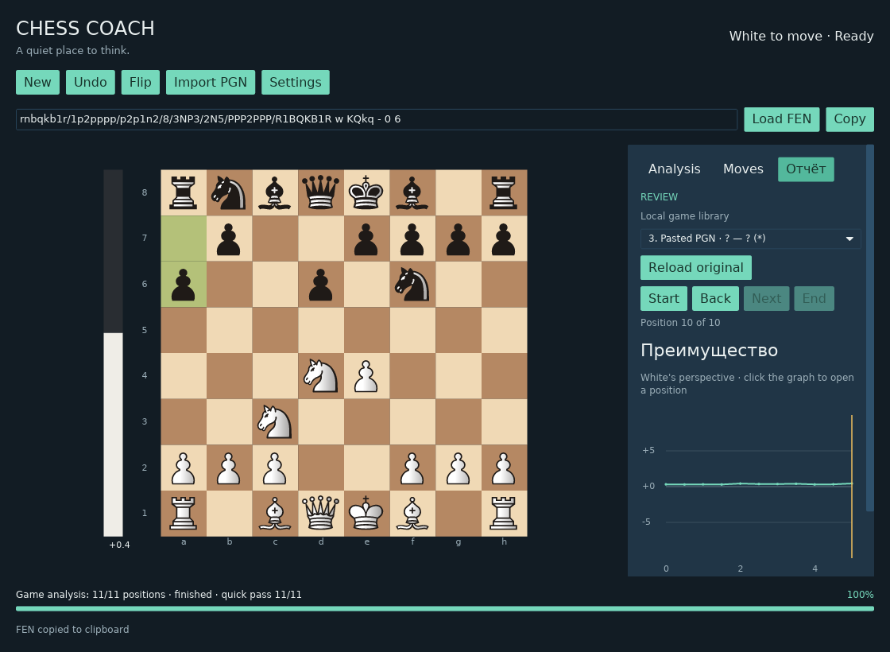

# Chess Coach

Chess Coach is a local desktop chessboard for playing through positions and reviewing a move list. It is an early, GPL-3.0-or-later Rust application.


Running application: local Stockfish analysis on Debian 13 (X11/Xvfb).

## What it does

- Play by dragging a piece to its destination, or clicking the piece and then the destination square. Pieces of either color can be dragged visually. Pieces of the side that is not to move show no legal hints and return on release. An illegal or outside drop leaves the position unchanged; Escape cancels a drag. The board marks the selected piece and last move; legal destinations use small dots on empty squares and soft shading for captures, with no outlines.
- Click moves, undo and adjacent review steps use a subtle 140 ms glide, including both castling pieces. Dragged pieces follow the pointer directly and do not replay the move after release. New games, FEN loads and long history jumps are instant.
- Choose a promotion piece explicitly. The rules, including check, checkmate, stalemate, castling, and en passant, are handled by `shakmaty`.
- Import one or more standard-chess games from PGN, then review the selected game's main line with the move list or previous/next controls.
- Play a different move while reviewing; the imported PGN stays available in the library so you can reload its original line or choose another imported game.
- Undo moves without losing the forward line; making a new move replaces only the future of the working line.
- Load a position from FEN and copy the current FEN. Invalid FEN leaves the current position and history intact.

Import PGN by pasting text or opening a `.pgn` file. Imports are parsed in a background worker and accepted atomically: if any game is invalid, the import is rejected and the current board is preserved. Limits are 8 MiB per import, 256 games, 2,048 plies per game, and 50,000 plies total. The exact source text and imported games are stored in a local SQLite library; identical PGN text reuses the existing import. The original source is never modified. PGN export and cloud or AI services are not included.

Loading or selecting an imported game automatically queues its entire main line for analysis, including the starting position. One Stockfish process analyzes positions sequentially using the current time/depth and resource settings. A persistent bottom status bar shows **Game analysis: X/Y positions**, percentage, a progress strip and the running/paused/finished/error state across all side-panel tabs. In two-pass mode, the percentage counts the quick and requested-limit work for each position; final completion counts positions, with quick-pass progress shown separately. Incomplete positions are listed separately. A started search finishes and is saved even if you navigate away; the open position gets the next search slot. At 1000 ms, a 40-move game needs at least about 81 seconds for the requested searches, plus the quick pass and overhead. Navigating to a completed position uses its result immediately while background analysis continues. **Analysis: OFF** pauses the queue and ON resumes it. This covers the selected game, not every game in a PGN collection. Completed analyses are stored in the library by game and engine/configuration identity, including the executable path, captured file size and modification time, limit, and position history. New/FEN clears the active queue; selecting another game, changing the engine path, or changing time/depth starts a queue for the new selection/configuration. Changing Threads/Hash preserves completed results and applies the new resources to pending searches. Exploring an alternative move leaves the imported original's background queue intact. Errors pause the queue; toggle analysis or adjust settings to retry. Searches stopped by the safety deadline are marked incomplete and are not saved. Completed results and the active game/cursor are restored after restart; pending searches resume automatically. Working branches and graph previews are not persisted.

The **Отчёт (Report)** tab shows the selected imported game's advantage graph as analysis completes. Positive values favor White; unknown scores are gaps. Click the graph to open a main-line position, including when exploring another branch. Move-quality classifications are not implemented yet.



Actual Debian 13 X11/Xvfb session after restarting an interrupted analysis; no mockup.

For local analysis, install Stockfish (or another UCI-compatible engine) separately. A saved custom path takes priority; otherwise the app can use `STOCKFISH_EXECUTABLE`, search `PATH`, and check `/usr/games/stockfish`; the engine is never bundled. Analysis starts automatically at launch and 300 ms after a position, FEN or review-navigation change. Selecting an imported game queues analysis immediately. One **Analysis: ON/OFF** toggle controls automatic analysis for this session; it defaults to ON at each launch. Set a bounded time limit (1–300000 ms, default 1000) or depth (1–128); depth searches have a 60-second safety deadline. Applying a different engine path or changing the limits cancels and restarts automatic analysis when enabled. Errors do not trigger automatic retry loops. Scores use White's perspective, and the principal variation uses UCI coordinate notation. A vertical bar beside the board shows a bounded centipawn balance, not win probability; unknown scores are neutral and mate scores are saturated, with M0 identifying the winner.


PGN review in the running application (Debian 13, X11/Xvfb).

The local library is stored at `ProjectDirs("org", "chess-coach", "chess-coach").data_local_dir()/library.sqlite3` (normally `~/.local/share/chess-coach/library.sqlite3` on Linux, respecting `XDG_DATA_HOME`). SQLite WAL may create adjacent `-wal` and `-shm` files; close the app before manually backing up the database. Unrecognized, newer or corrupt databases produce a visible error and are preserved.

## Build and run

Install Rust using `rustup`; this repository pins Rust 1.99.1 in `rust-toolchain.toml`. On Debian 13, install the native development packages and X11/Wayland runtime libraries:

```sh
sudo apt install build-essential pkg-config libwayland-dev libxkbcommon-dev \
  libx11-dev libxcursor-dev libxi-dev libxrandr-dev libxkbcommon-x11-0
```

Then run the desktop app from the repository root:

```sh
cargo run --locked -p desktop --bin chess-coach
```

On Debian/Hyprland, the native file picker needs a file-chooser portal backend or Zenity at runtime. For example: `sudo apt install xdg-desktop-portal xdg-desktop-portal-gtk zenity`. The wlroots/Hyprland screen-sharing portal alone may not provide a file chooser. Pasting PGN remains available if no dialog backend is installed.

The app uses the `iced` 0.14 UI toolkit with its `tiny-skia` software renderer and native Wayland/X11 backends. It does not use a Vulkan or `wgpu` renderer.

After import, the **Moves** tab shows the complete line and highlights the current move. Switching tabs preserves the position and any running analysis. The **Settings** toolbar button opens a settings dialog. **Engine** lets you save a Stockfish path with **Apply**; an empty path enables automatic discovery. **Cancel**, Escape, and closing the dialog discard path edits. **Appearance** provides controls for three bundled SVG piece sets (Merida, Celtic, RhosGFX), four board palettes, and custom palettes with a name and light/dark `#RRGGBB` colors. Appearance choices and the selected time/depth analysis mode and limit are saved in `appearance.json` under the user configuration directory.


## Stockfish and controls

On Debian, install the separate engine with `sudo apt install stockfish`. It normally lives at `/usr/games/stockfish`. For other systems, obtain a compatible executable from [Stockfish upstream](https://stockfishchess.org/download/) and enter its full path in **Settings → Engine** and choose **Apply**, or set `STOCKFISH_EXECUTABLE` before launching. Paths containing spaces are supported; shell expansions such as `~` are not performed. A missing engine does not prevent using the board or FEN.

Automatic analysis runs by default after launch and relevant position changes. Use the single **Analysis: ON/OFF** toggle to control it for the current session. Changing position cancels the old search and clears its evaluation. Depth searches have a 60-second safety deadline. Positive scores favor White, negative scores favor Black. `M+3` means White can mate in three moves; `M-3` means Black can mate in three. `M0` identifies the winner in an already mated position. The best move and principal variation are UCI coordinates, not SAN.

Click a piece, then its destination. Ctrl/Cmd+O opens PGN import, Ctrl/Cmd+N starts a new game, Ctrl/Cmd+Z undoes, Ctrl/Cmd+F flips; Escape cancels a selection or promotion. FEN can be submitted with Enter. No network service, account, telemetry or external API is required.

**Settings → Engine** also exposes **Threads** (1–1024) and **Hash (MiB)** (1–4096). Defaults use half the available logical CPU threads, capped at 8 and at least 1, plus 256 MiB of Hash. Values are saved with Apply; Cancel/Escape leave the active configuration unchanged. The engine's advertised limits are checked during initialization. Non-default settings require the corresponding UCI options. Hash is the search-cache size; the engine also uses memory for its networks and other data.

Stockfish stays running between related position searches, retaining its cache. Changing engine settings restarts it and releases the previous allocation. Turning analysis OFF stops the search while keeping the idle process/cache for reuse; closing the app terminates it. More threads can increase search work within the time limit, but do not make a 1000 ms search return immediately. Speedups depend on position and hardware. See [Stockfish's settings guidance](https://official-stockfish.github.io/docs/stockfish-wiki/Stockfish-FAQ.html#optimal-settings).

The application also keeps a 256-entry in-memory LRU cache for general position analysis. Returning to a position through the move list, undo, or review navigation immediately restores its score, depth, best move and PV without starting a new search, including when automatic analysis is OFF. Imported-game final analyses are persisted separately. The cache key includes position/history, engine executable path and identity, and the exact depth/time limit; Threads/Hash are execution settings. **Reanalyze**, or Enter in the limit field while analysis is ON, explicitly bypasses the cache. Canceled, failed and watchdog-stopped searches do not populate it. The in-memory cache clears on exit; the persistent imported-game analyses are stored in the local library.

## Validation and platform status

```sh
cargo build --workspace --all-targets --locked
cargo fmt --all -- --check
cargo test --workspace --locked
cargo clippy --workspace --all-targets --locked -- -D warnings
```

Ordinary tests do not require an engine. Run real-engine checks with `STOCKFISH_EXECUTABLE=/usr/games/stockfish cargo test -p engine --locked -- --nocapture`. See [development](docs/DEVELOPMENT.md) for details.

Debian 13 with Hyprland has been exercised under native Wayland; the X11 UI has also been exercised in Xvfb. The SQLite library and restart workflow were exercised on Debian 13 through X11/Xvfb. CI checks native builds, tests, Clippy and formatting on Linux, Windows and macOS; see the [current CI results](https://github.com/ronydzedun/chess-coach/actions/workflows/ci.yml) for the revision you are using. Graphical runtime on Windows/macOS remains unverified.

PGN review supports standard-chess main lines, SAN validation, UTF-8 text, BOM, comments, NAGs, `SetUp`/`FEN` positions, and multiple games per import. It rejects malformed or illegal moves, unsupported variants, invalid FEN, and games without a result. Variations can’t be reviewed or edited; comments aren’t displayed. There is no PGN export, graph-based move classification, training, or AI coach yet. Other prototype limits include a single analysis PV, and no automatic engine opponent or repetition/fifty-move claim UI. The move list starts fresh after FEN loading. The interface uses a bundled, licensed DejaVu Sans font. Board pieces are rendered from bundled SVG artwork; its artists and license terms are listed in [third-party notices](THIRD_PARTY_NOTICES.md).

## Workspace

- `chess-core` — transactional standard-chess state and notation.
- `engine` — asynchronous local UCI engine process service.
- `desktop` — the `chess-coach` application.
- `chess-library` — SQLite persistence for imported PGNs, completed game analyses and the active review cursor.

See [the architecture](docs/ARCHITECTURE.md), [development notes](docs/DEVELOPMENT.md), [contribution guide](CONTRIBUTING.md), [security policy](SECURITY.md), and [licensing notes](docs/LICENSING.md). Read the [Russian README](README.ru.md) for the Russian version.

## License

Chess Coach is distributed under the GNU General Public License, version 3 or later. See [LICENSE](LICENSE) and [LICENSING.md](docs/LICENSING.md).
