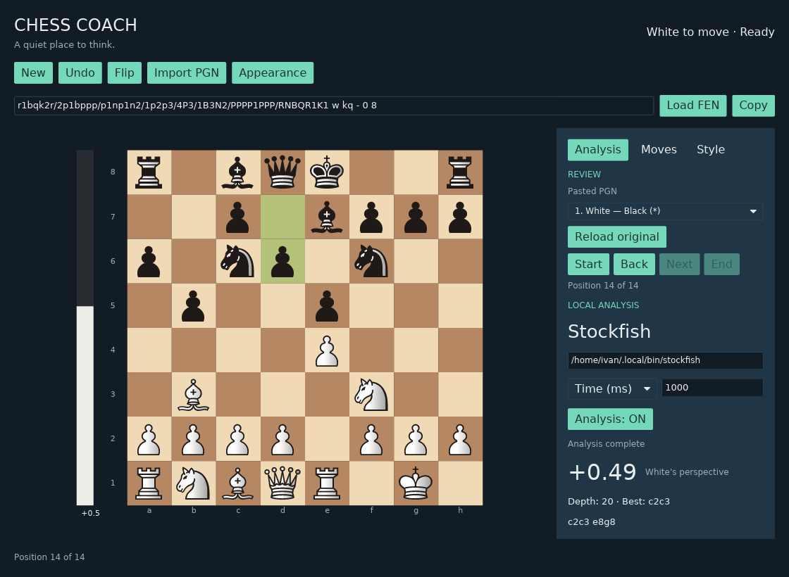
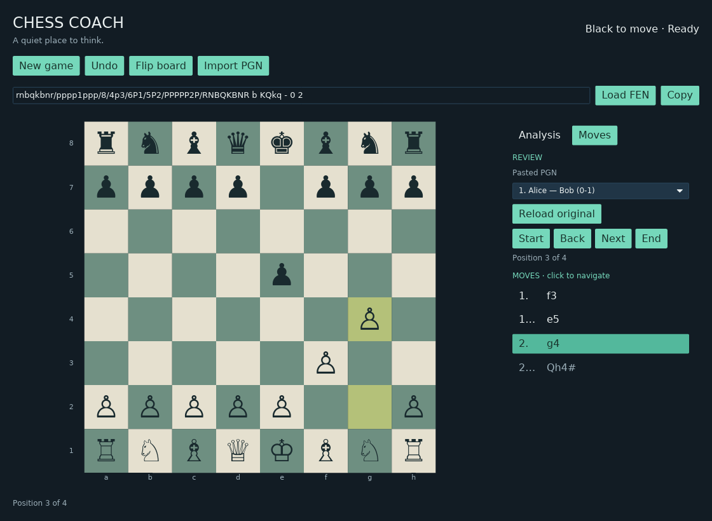
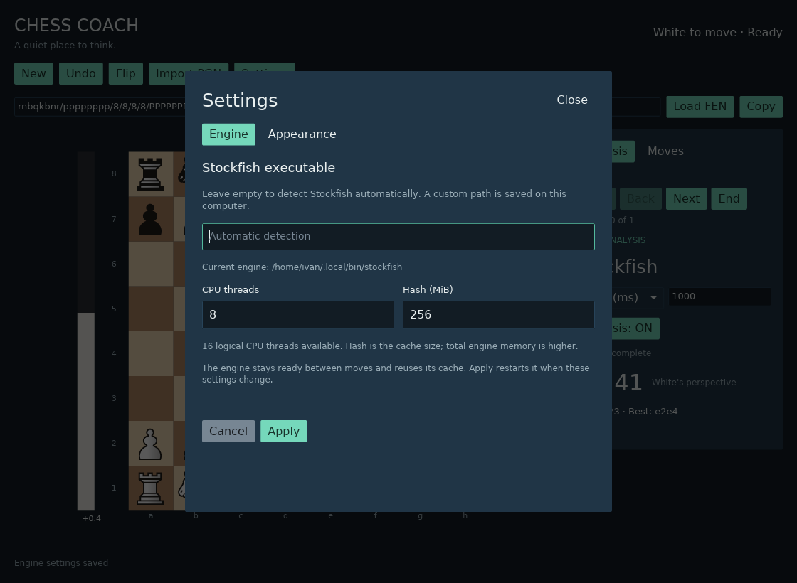
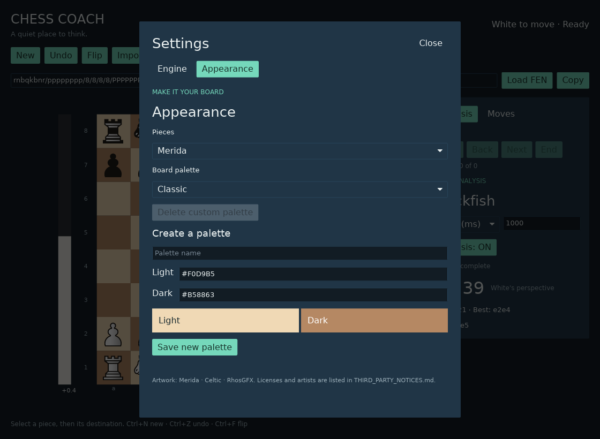

# Chess Coach

Chess Coach — локальное настольное приложение с шахматной доской для игры и разбора ходов. Это ранняя версия приложения на Rust под лицензией GPL-3.0-or-later.



Работающее приложение: локальный анализ Stockfish на Debian 13 (X11/Xvfb).

## Возможности

- Чтобы сделать ход, нажмите на фигуру, затем на поле назначения. Доска подсвечивает выбранную фигуру, допустимые поля и последний ход.
- При превращении пешки можно явно выбрать фигуру. Правила, включая шах, мат, пат, рокировку и взятие на проходе, реализованы с помощью `shakmaty`.
- Импортируйте одну или несколько партий из PGN и просматривайте основную линию выбранной партии по списку ходов или кнопками перехода.
- Во время просмотра можно сыграть другой ход. Исходный PGN остаётся в памяти: можно восстановить исходную линию или выбрать другую импортированную партию.
- Отмена хода сохраняет возможность вернуться вперёд; новый ход заменяет только последующую часть рабочей линии.
- Загружайте позицию в формате FEN и копируйте текущую FEN. При ошибке загрузки текущая позиция и история сохраняются.

Импортируйте PGN, вставив текст или открыв файл `.pgn`. Чтение файла и разбор выполняются в фоновой задаче. Импорт принимается целиком: если хотя бы одна партия некорректна, импорт отклоняется, а текущая доска сохраняется. Ограничения: 8 МиБ на импорт, 256 партий, 2048 полуходов в партии и 50 000 полуходов суммарно. Импортированные партии хранятся только в памяти; исходный файл не изменяется. Экспорт PGN, сохранение партий, облачные и ИИ-сервисы не предусмотрены.

Для локального анализа отдельно установите Stockfish или другой движок с поддержкой UCI. Сохранённый пользовательский путь имеет приоритет. При пустом пути приложение использует `STOCKFISH_EXECUTABLE`, ищет движок в `PATH` и проверяет `/usr/games/stockfish`; движок не входит в поставку. Анализ автоматически запускается при старте и через 300 мс после изменения позиции, FEN, импорта или перехода по партии. Один переключатель **Analysis: ON/OFF** управляет автозапуском в течение текущего сеанса; при каждом запуске приложения он включён. Можно задать ограниченное время (1–300000 мс, по умолчанию 1000) или глубину (1–128); для поиска по глубине действует защитный предел 60 секунд. Применение нового пути к движку или изменение лимита перезапускает анализ, если он включён. После ошибок автоматических повторов нет. Оценки показываются с точки зрения белых, а главный вариант — в координатной нотации UCI. Вертикальная полоса рядом с доской показывает ограниченный баланс сантипешек, а не вероятность победы; неизвестная оценка нейтральна, матовые оценки насыщены, а M0 указывает победителя.



Разбор PGN в работающем приложении (Debian 13, X11/Xvfb).

## Сборка и запуск

Установите Rust через `rustup`; в `rust-toolchain.toml` закреплена версия Rust 1.99.1. В Debian 13 установите системные пакеты для разработки и библиотеки X11/Wayland:

```sh
sudo apt install build-essential pkg-config libwayland-dev libxkbcommon-dev \
  libx11-dev libxcursor-dev libxi-dev libxrandr-dev libxkbcommon-x11-0
```

Из корневого каталога репозитория запустите приложение:

```sh
cargo run --locked -p desktop --bin chess-coach
```

Для системного выбора файла в Debian/Hyprland нужен backend FileChooser для XDG Desktop Portal или Zenity. Например: `sudo apt install xdg-desktop-portal xdg-desktop-portal-gtk zenity`. Одного portal-backend для захвата экрана wlroots/Hyprland может быть недостаточно. Без него остаётся импорт вставкой текста PGN.

Приложение использует UI-библиотеку `iced` 0.14 с программным рендерером `tiny-skia` и нативными бэкендами Wayland/X11. Рендерер Vulkan или `wgpu` не используется.

После импорта вкладка **Moves** показывает полную линию и выделяет текущий ход. Переключение вкладок сохраняет позицию и текущий анализ. Кнопка **Settings** открывает окно настроек. Раздел **Engine** позволяет указать путь к Stockfish и сохранить его кнопкой **Apply**; пустой путь включает автоматический поиск. **Cancel**, Escape и закрытие окна отбрасывают изменения пути. Раздел **Appearance** содержит настройки трёх наборов SVG-фигур (Merida, Celtic, RhosGFX), четырёх цветовых схем доски и пользовательских схем с именем и цветами `#RRGGBB` для светлых и тёмных полей. Настройки сохраняются в `appearance.json` в пользовательском каталоге конфигурации.





## Stockfish и управление

В Debian отдельно установите движок: `sudo apt install stockfish`. Обычно его путь — `/usr/games/stockfish`. Для других ОС загрузите подходящий исполняемый файл с [официального сайта Stockfish](https://stockfishchess.org/download/). Укажите полный путь в **Settings → Engine** и нажмите **Apply** или задайте переменную `STOCKFISH_EXECUTABLE` перед запуском. Пробелы в пути допустимы; раскрытие `~` и других shell-выражений не выполняется. Без движка доска и FEN продолжают работать.

Автоматический анализ включён по умолчанию и запускается после старта и соответствующих изменений позиции. Переключатель **Analysis: ON/OFF** управляет им в текущем сеансе. Изменение позиции отменяет поиск и очищает прежнюю оценку. У анализа по глубине есть защитный предел 60 секунд. Положительная оценка означает преимущество белых, отрицательная — чёрных. `M+3` означает мат со стороны белых в три хода, `M-3` — со стороны чёрных. Для `M0` указан победитель. Лучший ход и вариант показаны в координатной нотации UCI.

Ctrl/Cmd+O — импорт PGN, Ctrl/Cmd+N — новая партия, Ctrl/Cmd+Z — отмена, Ctrl/Cmd+F — переворот, Escape — отмена выбора или превращения. Стрелки влево/вправо и Home/End перемещают по истории PGN, если фокус не находится в текстовом поле. Ввод FEN подтверждается Enter. Аккаунты, телеметрия, сетевые службы и внешние API для работы не нужны.

В **Settings → Engine** доступны **Threads** (1–1024) и **Hash (MiB)** (1–4096). По умолчанию используется половина доступных логических потоков процессора, от 1 до 8, и 256 МиБ Hash. **Apply** сохраняет значения; Cancel/Escape оставляют действующие настройки. При инициализации проверяются пределы, объявленные самим движком. Для нестандартных значений нужны соответствующие UCI-опции. Hash задаёт размер кеша поиска; нейросети и другие данные движка требуют дополнительной памяти.

Stockfish остаётся запущенным между поисками связанных позиций и сохраняет кеш. Применение новых настроек перезапускает его и освобождает прежнюю выделенную память. Переключатель OFF останавливает поиск, сохраняя неактивный процесс и кеш; закрытие приложения завершает процесс. Дополнительные потоки позволяют выполнить больше поиска за заданное время, но не сокращают сам лимит 1000 мс. Ускорение зависит от позиции и оборудования. См. [рекомендации Stockfish](https://official-stockfish.github.io/docs/stockfish-wiki/Stockfish-FAQ.html#optimal-settings).

## Проверки и ограничения

```sh
cargo build --workspace --all-targets --locked
cargo fmt --all -- --check
cargo test --workspace --locked
cargo clippy --workspace --all-targets --locked -- -D warnings
```

Для тестов с настоящим движком: `STOCKFISH_EXECUTABLE=/usr/games/stockfish cargo test -p engine --locked -- --nocapture`. Основные тесты обходятся без Stockfish.

Приложение запущено на Debian 13 + Hyprland в нативном Wayland. Интерфейс также проверяется через X11/Xvfb. При необходимости явно выбрать Wayland можно запустить `env -u DISPLAY cargo run --locked -p desktop --bin chess-coach` из работающей Wayland-сессии. Настройки Hyprland менять не требуется. Сборка и запуск выполняются обычным пользователем; root нужен только для установки системных пакетов.

Весь workspace прошёл кросс-проверку `cargo check` для Windows GNU и macOS Darwin. CI проверяет нативную сборку, тесты, Clippy и форматирование на Linux, Windows и macOS: см. [текущие результаты CI](https://github.com/ronydzedun/chess-coach/actions/workflows/ci.yml) для используемой версии. Запуск графического окна на Windows/macOS ещё не проверен.

Просмотр PGN поддерживает основную линию стандартных шахмат, проверку SAN, UTF-8, BOM, комментарии, NAG, начальные позиции `SetUp`/`FEN` и несколько партий в одном импорте. Некорректные или нелегальные ходы, неподдерживаемые варианты, неверная FEN и партии без результата отклоняются. Варианты нельзя просматривать или редактировать, комментарии не отображаются. Пока нет экспорта PGN, сохранения партий, графиков, тренировок и ИИ-наставника. Другие ограничения прототипа: ходы двумя кликами без drag-and-drop, один вариант анализа, нет автоматического соперника и интерфейса заявления ничьей по повторению/50 ходам. После загрузки FEN список ходов начинается заново. Интерфейс использует встроенный лицензированный шрифт DejaVu Sans. Шахматные фигуры отображаются из встроенных SVG-файлов; сведения об авторах и лицензиях приведены в [уведомлениях о сторонних компонентах](THIRD_PARTY_NOTICES.md).

## Состав workspace

- `chess-core` — состояние стандартной шахматной партии и нотация с транзакционным применением ходов.
- `engine` — асинхронная служба локального UCI-движка.
- `desktop` — приложение `chess-coach`.

Подробнее: [архитектура](docs/ARCHITECTURE.md), [разработка](docs/DEVELOPMENT.md), [правила участия](CONTRIBUTING.md), [безопасность](SECURITY.md), [лицензирование](docs/LICENSING.md). Документация на английском находится в [README.md](README.md).

## Лицензия

Chess Coach распространяется по GNU General Public License версии 3 или более поздней. См. [LICENSE](LICENSE) и [LICENSING.md](docs/LICENSING.md).
